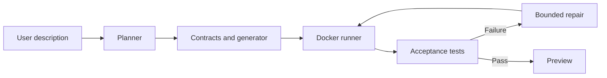

# Technical case study: Intelligent Productivity Suite

## Problem
Generated applications can appear complete while failing functional requirements. A generation pipeline needs independent acceptance checks and bounded repair.

## Approach
A local Python desktop project uses Ollama, planning, generation, application contracts, Docker execution, repair and preview components.

Conceptual component flow.

## Evidence and evaluation
[Handoff](CODEX_HANDOFF.md), [architecture](ARCHITECTURE.md) and [testing](TESTING.md) document the implementation and historical task-manager and repair-trial results. Independent acceptance tests should not be weakened during repair. Generator tests alone are insufficient.

## Reproduction
Use the documented local prerequisites and run `python -m suite.desktop_preview`. Review the handoff before executing generated code.

## Limitations
Historical results were not rerun for this case study. Expense-tracker behavior remains unverified; local model and container dependencies affect reproducibility.

## Resume summary
Developed a local AI-assisted application generation pipeline with explicit contracts, isolated execution, browser acceptance testing and bounded repair.
