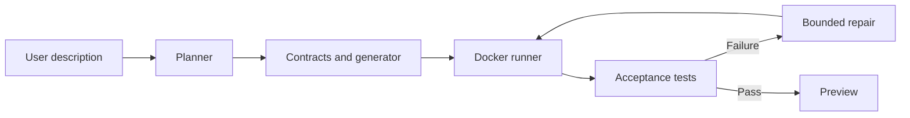

# Technical case study: Intelligent Productivity Suite

## Problem
Generated applications can appear complete while failing functional requirements. A generation pipeline needs independent acceptance checks and bounded repair.

## Approach
A local Python desktop project uses Ollama, planning, generation, application contracts, Docker execution, repair and preview components.


Conceptual component flow.

## Evidence and evaluation
[Handoff](CODEX_HANDOFF.md), [architecture](ARCHITECTURE.md) and [testing](TESTING.md) document the implementation and historical task-manager and repair-trial results. Independent acceptance tests should not be weakened during repair. Generator tests alone are insufficient.

## Reproduction
Use the documented local prerequisites and run `python -m suite.desktop_preview`. Review the handoff before executing generated code.

## Limitations
Historical results were not rerun for this case study. Expense-tracker behavior remains unverified; local model and container dependencies affect reproducibility.

## Reproducible fixture demonstration

The fixture supplies `Synthetic task manager` with the acceptance criterion `Persist tasks`. The contract should retain that criterion, specify five routes, return 201 for task creation and 204 for deletion, produce identical results for repeated inputs, and reject a spec without acceptance criteria. This scenario needs neither an Ollama model nor a running container.

```sh
python -m unittest discover -s tests -v
```

## Resume summary
Developed a local AI-assisted application generation pipeline with explicit contracts, isolated execution, browser acceptance testing and bounded repair.

## Verified CI evidence — 2026-11-25

4 deterministic contract tests passed; no live model or generated application execution.

[Completed run](https://github.com/robbiecalvin/productivitysuite/actions/runs/45642859178) · [Tested revision](https://github.com/robbiecalvin/productivitysuite/commit/c0fa7624df6c03e0a28af15494ad668b2accf60c)
